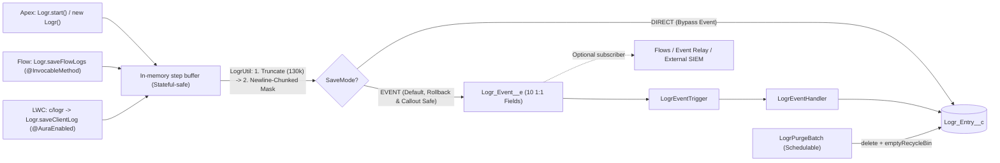

# Logr — Lean Salesforce Logging & Telemetry Framework

**Logr** is a lightweight, general-purpose logging and telemetry library for Salesforce (**Apex**, **Flow**, and **Lightning Web Components**). Instead of scattering one database row per `debug()` line across custom LWC viewers, `Logr` buffers step-by-step execution traces in memory and persists a **single structured `Logr_Entry__c` record per unit of work**.

---

## ✨ Key Features

- **Unit-of-Work Step Buffering**: Captures timestamped steps (`+elapsedMs`) separated by `\n----------\n` into a single `Logr_Entry__c` record with automatic severity escalation (`FINE` → `DEBUG` → `INFO` → `WARN` → `ERROR`).
- **Dual Persistence Modes (`EVENT` & `DIRECT`)**:
  - **`EVENT` (Default)**: Publishes a `PublishImmediately` Platform Event (`Logr_Event__e`) with an exact 1:1 field mapping—survives transaction rollbacks and never triggers `System.CalloutException: You have uncommitted work pending` before HTTP callouts.
  - **`DIRECT`**: Performs a direct `Database.insert(entries, false, AccessLevel.SYSTEM_MODE)` when Platform Event delivery isn't needed.
- **Flush Debug on Error**: Keeps `DEBUG` and `FINE` breadcrumbs in memory at zero database cost during normal `INFO` runs, but automatically flushes them into `Body__c` if the transaction encounters an `ERROR`.
- **Built-in Telemetry Helpers**:
  - `log.callout(label, req, res)` — Formats `HttpRequest`/`HttpResponse` payloads and auto-escalates `4xx` to `WARN` and `5xx`/`null` to `ERROR`.
  - `log.dmlResults(label, saveResults, records)` — Inspects `Database.SaveResult[]` partial DML operations, captures affected Record IDs, and logs row-level errors.
- **Newline-Chunked Regex PII Masking**: Scrubs sensitive data (`Credit_Card`, `Email_Address`, `US_SSN`, `US_Phone`, `IPv4_Address`, plus custom `Logr_Data_Mask_Rule__mdt` rules) in ~2,000-character newline-bounded windows so Apex's 1,000,000-step regex governor limit never trips on 130KB payloads.
- **Governor-Limit Self-Defense & Heap Checkpointing**: Automatically snapshots CPU, SOQL, DML, and Heap usage on every log entry and checkpoints `Logr_Event__e` trigger batches at 200 events / 1.5M chars so 2,000-event bursts never hit the 6 MB heap limit.

---

## 📦 Installation

### Option 1: Unlocked Package (`Logr@1.1.0-1`)

- **Production / Developer Edition**:  
  👉 [**Install Logr v1.1.0-1 (`04tg7000000ZCRJAA4`)**](https://login.salesforce.com/packaging/installPackage.apexp?p0=04tg7000000ZCRJAA4)
- **Sandbox**:  
  👉 [**Install Logr v1.1.0-1 in Sandbox**](https://test.salesforce.com/packaging/installPackage.apexp?p0=04tg7000000ZCRJAA4)
- **Salesforce CLI**:
  ```bash
  sf package install --package 04tg7000000ZCRJAA4 --target-org <your-org-alias> --apex-compile package --wait 10
  ```

### Option 2: Direct Source Deployment

```bash
git clone https://github.com/nithesh1992/Logr.git
cd Logr
sf project deploy start --source-dir force-app/main/default/Logr --target-org <your-org-alias>
```

### Post-Install Setup

1. **Assign Permission Set**:
   - Assign **`Logr_Admin`** to admins/developers who view logs, reports, and dashboards:
     ```bash
     sf org assign permset --name Logr_Admin --target-org <your-org-alias>
     ```
   - Or assign **`Logr_User`** to end users who only trigger LWC/Flow logs.
2. **(Optional) Schedule Nightly Log Retention Purge**:
   ```apex
   // Deletes Logr_Entry__c records older than Logr_Config__c.Retention_Days__c (default 30 days)
   // and purges them from the Recycle Bin daily at 2:00 AM
   System.schedule('Logr Nightly Purge', '0 0 2 * * ?', new LogrPurgeBatch());
   ```

---

## 🏗️ Architecture



---

## 🚀 Usage

### 1. Apex (`Logr.cls`)

```apex
Logr log = Logr.start('Order Fulfillment')
    .tag('OMS')
    .recordIds(orders); // Accepts single Id, String, Set<Id>, Iterable<String>, or List<SObject>

log.add('Validated order header');          // .add() is a shorthand alias for .info()
log.debug('Order lines', orderLines);       // Buffered in memory; auto-flushed to Body__c if an error occurs!

try {
    HttpResponse res = SapClient.sendOrder(req);
    log.callout('SAP Order API', req, res); // INFO on 2xx, WARN on 4xx, ERROR on 5xx

    Database.SaveResult[] srs = Database.update(orders, false);
    log.dmlResults('Update Orders', srs, orders); // Logs succeeded/failed counts & escalates on row errors
} catch (Exception e) {
    log.error('SAP sync failed', e).recordId(order.Id);
} finally {
    log.save();           // Uses Logr_Config__c.Default_Save_Mode__c (EVENT by default)
    // log.saveDirect();   // Explicit Direct DML insert into Logr_Entry__c
    // log.saveViaEvent(); // Explicit Platform Event publish
}
```

### 2. Lightning Web Components (`c/logr`)

```javascript
import { createLogger, logError } from 'c/logr';

// Buffered multi-step unit-of-work logger
const log = createLogger('Checkout Payment', 'checkoutSummary')
    .tag('Stripe')
    .recordId(this.orderId);

log.info('Submitting payment token');
try {
    await processPayment();
    log.info('Payment authorized');
} catch (err) {
    log.error('Payment failed', err);
} finally {
    await log.flush();
}

// Or one-liner fire-and-forget helper:
await logError('Checkout Error', error, {
    source: 'checkoutSummary',
    tags: 'Checkout, Stripe',
    recordId: this.orderId
});
```

### 3. Salesforce Flow (`Save Logr Entry` Action)

In Flow Builder, add an **Action** element and select **`Save Logr Entry`** (Category: `Logr`):
- **Subject** *(Required)*: Short summary of the flow execution or fault
- **Message / Body**: Detailed message or variable values
- **Level**: `ERROR`, `WARN`, `INFO`, `DEBUG`, or `FINE` (defaults to `INFO`, or auto-escalates to `ERROR` when `Fault Message` is provided)
- **Source**: Flow API Name (e.g., `Order_After_Save_Flow`)
- **Tags**: Comma-separated tags (e.g., `OMS, Flow`)
- **Record ID(s)**: Single or comma-separated record/correlation IDs
- **Fault Message**: `{!$Flow.FaultMessage}`
- **Save Mode**: `EVENT` (default) or `DIRECT`

---

## ⚙️ Configuration & Data Masking

### `Logr_Config__c` (Hierarchy Custom Setting)
Supports Org-wide defaults as well as per-Profile and per-User overrides in **Setup → Custom Settings → Logr Config**. Works out of the box with zero configuration required:

| Field API Name | Default | Description |
|---|---|---|
| `Enabled__c` | `true` | Master kill switch |
| `Level__c` | `'INFO'` | Minimum severity level to persist (`ERROR`, `WARN`, `INFO`, `DEBUG`, `FINE`) |
| `Default_Save_Mode__c` | `'EVENT'` | Default persistence mode (`'EVENT'` or `'DIRECT'`) |
| `Flush_Debug_On_Error__c` | `true` | Retains `DEBUG`/`FINE` steps in memory and flushes them into `Body__c` if an `ERROR` occurs |
| `Mask_Data__c` | `true` | Scrubs sensitive PII using active `Logr_Data_Mask_Rule__mdt` records |
| `Retention_Days__c` | `30` | Days to retain `Logr_Entry__c` records before `LogrPurgeBatch` deletes them |

### `Logr_Data_Mask_Rule__mdt` (Custom Metadata Type)
Ships with 5 active rules (`Credit_Card`, `Email_Address`, `US_SSN`, `US_Phone`, `IPv4_Address`). Add or toggle rules in **Setup → Custom Metadata Types → Logr Data Mask Rule**.

---

## 📂 Project Structure

```text
force-app/main/default/Logr/
├── classes/
│   ├── Logr.cls & .cls-meta.xml                     # Public fluent API + Flow @InvocableMethod + LWC @AuraEnabled
│   ├── LogrUtil.cls & .cls-meta.xml                 # Internal helper: formatting, caller parser, PII masking & persistence
│   ├── LogrEventHandler.cls & .cls-meta.xml         # Trigger handler for Logr_Event__e -> Logr_Entry__c
│   ├── LogrPurgeBatch.cls & .cls-meta.xml           # Schedulable + Batchable retention cleanup + emptyRecycleBin
│   ├── LogrTest.cls & .cls-meta.xml                 # 1:1 unit test suite for Logr.cls (97% coverage)
│   ├── LogrUtilTest.cls & .cls-meta.xml             # 1:1 unit test suite for LogrUtil.cls (94% coverage)
│   ├── LogrEventHandlerTest.cls & .cls-meta.xml     # 1:1 unit & bulk test suite for LogrEventHandler.cls (100% coverage)
│   └── LogrPurgeBatchTest.cls & .cls-meta.xml       # 1:1 unit test suite for LogrPurgeBatch.cls (100% coverage)
├── triggers/
│   └── LogrEventTrigger.trigger & .trigger-meta.xml # Logicless trigger delegating to LogrEventHandler (100% coverage)
├── lwc/
│   └── logr/                                        # Headless LWC logger service + Jest test suite
├── objects/
│   ├── Logr_Entry__c/                               # Custom Object (with View FlexiPage override) + 10 fields + 3 List Views
│   ├── Logr_Event__e/                               # Platform Event + 10 1:1 fields
│   ├── Logr_Config__c/                              # Hierarchy Custom Setting + 6 fields
│   └── Logr_Data_Mask_Rule__mdt/                    # Custom Metadata Type + 4 fields
├── customMetadata/                                  # 5 pre-configured PII masking rules
├── flexipages/                                      # Log_Entry_Record_View (Execution Context + Execution Trace)
├── layouts/                                         # Logr_Entry__c-Logr Entry Layout
├── tabs/                                            # Logr_Entry__c Custom Tab
├── dashboards/Logr_Dashboards/                      # Logr_Dashboard (Operations & Telemetry Dashboard)
├── reports/Logr_Reports/                            # 5 pre-built Logr telemetry & exception reports
└── permissionsets/                                  # Logr_Admin & Logr_User
```
