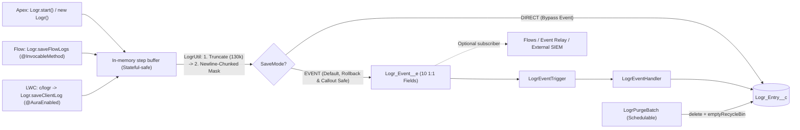

# Logr for Salesforce

[](https://developer.salesforce.com/)
[](https://developer.salesforce.com/)
[]()
[](LICENSE)

**Logr** is a lightweight, privacy-first, general-purpose **logging and telemetry framework** for Salesforce. It captures step-by-step execution traces, HTTP callout telemetry, partial DML results, and exceptions across **Apex**, **Lightning Web Components**, **Flows**, and **Batch Jobs** into a single structured `Logr_Entry__c` record per unit of work.

---

## 💡 Why I Built Logr

Before building **Logr**, I evaluated the most popular open-source Salesforce logging frameworks—**Nebula Logger**, **RFLIB**, and **Bolt Logger**:

- **Nebula Logger** and **RFLIB** are powerful, enterprise-scale frameworks, but they come with a massive metadata footprint (dozens of Apex classes, custom objects, custom LWC log viewers, and Big Object archival pipelines). When you want a clean, maintainable org without metadata bloat or Big Object complexity, they feel far too heavy.
- **Bolt Logger** is refreshingly lightweight and easy to understand—which I loved—but it only handles **error logs**.
- What I actually needed was a **multi-purpose logging and telemetry utility**: something just as lean as Bolt Logger, but capable of capturing step-by-step execution breadcrumbs, API callout payloads, partial DML summaries, and performance metrics alongside exceptions.

Drawing from a battle-tested logging utility I had built in a previous org, I created **Logr**—designed to cover 95% of real-world observability and debugging needs with **minimal metadata** (4 production Apex classes, 1 custom object, 1 platform event, and 10 fields).

---

## ⚖️ How Logr Compares

| Capability | **Logr** | **Bolt Logger** | **Nebula Logger** | **RFLIB** |
| :--- | :--- | :--- | :--- | :--- |
| **Primary Scope** | **General Telemetry + Breadcrumbs + Errors** | Error Logging Only | Enterprise Logging Suite | Enterprise Logging + Framework Suite |
| **Metadata Footprint** | **Ultra-Lean** *(4 Prod Classes, 1 Object, 10 Fields)* | **Lightweight** *(5 Prod Classes, 1 Object)* | **Heavy** *(60+ Classes, Multiple Objects & LWCs)* | **Heavy** *(Large Class & Object Footprint)* |
| **Big Object Archival Overhead** | **No** *(Clean Batch Purge + Recycle Bin Empty)* | **No** | **Yes** *(Big Objects included)* | **Yes** *(Big Objects included)* |
| **Log Storage Model** | **1 Record per Unit of Work** *(Buffered steps in `Body__c`)* | 1 Record per Error | Parent Transaction + Child Entry Rows | Event / Log Rows |
| **Persistence Modes** | **Dual (`EVENT` + `DIRECT` DML)** | Platform Event Only | Platform Event / Queueable | Platform Event / Direct |
| **Smart "Flush Debug on Error"** | **Yes** *(Zero DB cost on success; flushes `DEBUG` steps if an `ERROR` occurs)* | No | Yes | Yes |
| **Built-in Callout & DML Helpers** | **Yes** (`log.callout()`, `log.dmlResults()`) | Manual string formatting | Callout builders | Manual |
| **Per-User / Per-Profile Config** | **Yes** (`Logr_Config__c` Hierarchy Custom Setting) | Org-wide Custom Metadata only | Yes | Yes |
| **PII Regex Scrubbing** | **Newline-chunked (Safe up to 130KB)** | Truncates to 2,000 chars before regex | Custom plugins / rules | Custom rules |

---

## ⚡ Key Features

* **Unit-of-Work Step Buffering:** Instead of burning DML and storage with one row per `debug()` statement, `Logr` buffers timestamped steps (`+elapsedMs`) in memory and writes **one `Logr_Entry__c` record** joined by `\n----------\n`.
* **Dual Save Modes (`EVENT` & `DIRECT`):**
  * **`EVENT` (Default):** Publishes a `PublishImmediately` Platform Event (`Logr_Event__e`). Survives transaction rollbacks and **never** causes `System.CalloutException: You have uncommitted work pending` before HTTP callouts.
  * **`DIRECT`:** Inserts `Logr_Entry__c` directly via `Database.insert(..., AccessLevel.SYSTEM_MODE)` when Platform Event delivery isn't needed.
* **Flush Debug on Error:** Keep org-wide logging at `INFO` in Production while leaving `.debug()` and `.fine()` steps in your code. If a transaction succeeds, `DEBUG` steps are discarded; if an exception or `ERROR` occurs, all buffered `DEBUG`/`FINE` steps are automatically flushed into `Body__c` so you have the full breadcrumb trail.
* **First-Class Callout & DML Telemetry:**
  * `log.callout(label, req, res)` captures HTTP method, endpoint, status code, and request/response bodies—automatically escalating `4xx` responses to `WARN` and `5xx`/`null` responses to `ERROR`.
  * `log.dmlResults(label, saveResults, records)` inspects `Database.SaveResult[]` operations, collects affected Record IDs, and logs row-level failure messages.
* **Auto-Caller & Quiddity Detection:** Automatically stamps `Source__c` with the calling `ClassName.methodName` and execution context (`(SYNC)`, `(QUEUEABLE)`, `(BATCH)`, `(FUTURE)`, `(AFTER_UPDATE)`, `(FLOW)`, `(LWC)`).
* **Governor-Safe Dynamic PII Scrubbing:** Ships with **5 active regex rules** (Credit Card, Email, US SSN, US Phone, IPv4) that run in ~2,000-character newline-bounded windows—preventing Apex's `System.LimitException: Regex too complicated` even on 130,000-character payloads.
* **Smart Head + Tail Truncation:** If a log body exceeds 130,000 characters, `Logr` preserves the first **60,000 characters** (initial setup context) and the last **65,000 characters** (where the failure occurred) rather than chopping off the end of the trace.
* **Zero-Config Ready:** Works immediately after installation with sensible defaults (`Enabled = true`, `Level = INFO`, `SaveMode = EVENT`, `Flush_Debug_On_Error = true`, `Mask_Data = true`, `Retention_Days = 30`).

---

## 🔍 What a `Logr_Entry__c` Trace Looks Like

Every unit of work produces a single clean record on the **Log Entries** tab:

- **Subject:** `Order Fulfillment`
- **Level:** `ERROR` *(auto-escalated from highest step)*
- **Source:** `OrderService.fulfillOrder (QUEUEABLE)`
- **Tags:** `OMS, SAP, Checkout`
- **Records:** `801g7000001abcDAAQ, EXT-ORD-9941`
- **Governor Limits:** `Time: 506ms | CPU: 48/10000ms | SOQL: 3/100 | DML: 1/150 | Heap: 124/6000KB`
- **Body (`Body__c`):**
```text
[14:22:01.104 | +0ms | INFO] Validated order header
----------
[14:22:01.189 | +85ms | DEBUG] Order lines:
[ {
  "Id" : "802g7000000xyz1AAA",
  "Quantity" : 2
} ]
----------
[14:22:01.610 | +506ms | ERROR] SAP Order API
POST https://api.sap.example.com/v1/orders
Request Body: {"orderId":"EXT-ORD-9941","email":"[REDACTED-EMAIL]"}
Status: 503 Service Unavailable
Response Body: {"error":"Upstream gateway timeout"}
```

---

## 📦 Installation

Choose **one** of the following methods to install **Logr**.

### Option 1: Unlocked Package (Recommended)
Install the pre-built Unlocked Package (`Logr@1.1.0-1`) directly into your environment:

[](https://login.salesforce.com/packaging/installPackage.apexp?p0=04tg7000000ZCRJAA4)
[](https://test.salesforce.com/packaging/installPackage.apexp?p0=04tg7000000ZCRJAA4)

**Or install via Salesforce CLI:**
```bash
sf package install --package 04tg7000000ZCRJAA4 --target-org <target-org-alias> --apex-compile package --wait 10
```

### Option 2: Deploy Source Code (Developers)
Clone this repository and deploy the metadata directly using the Salesforce CLI:

```bash
# 1. Clone the repository
git clone https://github.com/nithesh1992/Logr.git
cd Logr

# 2. Authorize your target org
sf org login web --set-default --alias my-org

# 3. Deploy the Logr metadata
sf project deploy start --source-dir force-app/main/default/Logr --target-org my-org
```

---

## ✅ Post-Installation Setup

### 1. Assign Permission Sets
**Logr** includes two permission sets to separate administrative visibility from end-user log generation:

* **`Logr_Admin`** *(Developers, Architects, System Admins)*:
  * Grants full access to the **`Logr_Entry__c`** tab, **`Log_Entry_Record_View`** Lightning page, **`Logr_Dashboard`**, and **`Logr_Reports`** folder.
  * Assign via CLI:
    ```bash
    sf org assign permset --name Logr_Admin --target-org <target-org-alias>
    ```
* **`Logr_User`** *(Standard End Users, Experience Cloud Users)*:
  * Grants access to `Logr.cls` so users can trigger LWC and Flow logs without having read access to `Logr_Entry__c` records.

### 2. Configure Hierarchy Settings (Optional — Works Out of the Box!)
Unlike frameworks that only support org-wide Custom Metadata, **Logr** uses a **Hierarchy Custom Setting (`Logr_Config__c`)** so you can keep the Org Default at `INFO` while temporarily enabling `DEBUG` or `FINE` for a **single User or Profile** in Production without noise!

> **Note:** No setup is required after installation. When no `Logr_Config__c` record exists, `Logr` automatically defaults to `Enabled = true`, `Level = INFO`, `Default_Save_Mode = EVENT`, `Flush_Debug_On_Error = true`, `Mask_Data = true`, and `Retention_Days = 30`.

To customize settings or add a per-user override:
1. Go to **Setup > Custom Settings**.
2. Click **Manage** next to **Logr Config**.
3. Click **New** (top button for Org Default, or bottom button for a specific Profile/User):
   * **Enabled (`Enabled__c`):** Master kill switch (`true`).
   * **Level (`Level__c`):** Minimum severity to persist (`ERROR`, `WARN`, `INFO`, `DEBUG`, `FINE`).
   * **Default Save Mode (`Default_Save_Mode__c`):** `EVENT` (default) or `DIRECT`.
   * **Flush Debug On Error (`Flush_Debug_On_Error__c`):** Automatically include `DEBUG`/`FINE` steps when a log ends in `ERROR` (`true`).
   * **Mask Data (`Mask_Data__c`):** Scrub sensitive PII before saving (`true`).
   * **Retention Days (`Retention_Days__c`):** Days to keep logs before `LogrPurgeBatch` deletes them (`30`).

### 3. Customize PII Scrubbing Rules 🛡️
**Logr** ships with **5 active Custom Metadata rules** out of the box (`Credit_Card`, `Email_Address`, `US_SSN`, `US_Phone`, `IPv4_Address`).

To customize or add your own regex patterns (e.g., proprietary account keys or tokens):
1. Go to **Setup > Custom Metadata Types**.
2. Click **Manage Records** next to **Logr Data Mask Rule**.
3. Click **New** or **Edit** an existing rule:
   * **Regex (`Regex__c`):** Regular expression to match.
   * **Replacement (`Replacement__c`):** Replacement token (e.g., `[REDACTED-EMAIL]`, `***`).
   * **Is Active (`Is_Active__c`):** Toggle on or off without deploying code.
   * **Sort Order (`Sort_Order__c`):** Controls execution order (lower numbers run first).

---

## 🧹 Data Retention & Cleanup

To keep your org's data storage lean, schedule **`LogrPurgeBatch`** to automatically delete expired `Logr_Entry__c` records and hard-purge them from the Salesforce Recycle Bin (`Database.emptyRecycleBin`).

### Schedule Nightly Cleanup
Run this one-liner in **Execute Anonymous Apex** (or schedule `LogrPurgeBatch` via **Setup > Apex Classes > Schedule Apex**):
```apex
// Runs daily at 2:00 AM using Logr_Config__c.Retention_Days__c (default 30 days)
System.schedule('Logr Nightly Purge', '0 0 2 * * ?', new LogrPurgeBatch());
```

### Run an Immediate Manual Purge
```apex
// Purge logs older than the configured Retention_Days__c
Database.executeBatch(new LogrPurgeBatch(), 2000);

// Or pass an explicit retention window (e.g., delete logs older than 7 days)
Database.executeBatch(new LogrPurgeBatch(7), 2000);
```

---

## 🚀 Usage Guide

### 1. Logging from Apex (Fluent Unit-of-Work API)
Create a `Logr` instance at the start of your method, add breadcrumbs/telemetry as your code executes, and call `log.save()` once in your `finally` block:

```apex
public void processOrder(Order ord, List<OrderItem> items) {
    Logr log = Logr.start('Process Customer Order')
        .tag('OMS')
        .recordId(ord.Id);

    log.add('Validated order header');          // .add() is a clean alias for .info()
    log.debug('Order items payload', items);    // Kept in memory; flushed to Body__c if an error occurs!

    try {
        // 1. Log HTTP Callout Telemetry (INFO on 2xx, WARN on 4xx, ERROR on 5xx)
        HttpRequest req = SapClient.buildRequest(ord, items);
        HttpResponse res = new Http().send(req);
        log.callout('SAP Order Sync', req, res);

        // 2. Log Partial DML Results (Database.SaveResult[])
        Database.SaveResult[] results = Database.update(items, false);
        log.dmlResults('Update Order Items', results, items);

    } catch (Exception ex) {
        // Captures exception message, causal chain, stack trace, and failed DML IDs
        log.error('Order processing failed', ex);
    } finally {
        log.save();           // Uses Default_Save_Mode__c (EVENT by default)
        // log.saveDirect();   // Force direct DML insert into Logr_Entry__c
        // log.saveViaEvent(); // Force Platform Event publish
    }
}
```

### 2. Logging Across Multiple Services or Batch Chunks
* **Multiple Loggers in One Transaction:** Call `Logr.saveAll()` at the end of a trigger or handler to bulk-flush every active `Logr` instance in a single `EventBus.publish()` or `Database.insert()` call.
* **`Database.Stateful` Batch Apex:** `Logr` serializes all payloads to primitive strings immediately when added, so a `Logr` instance can be safely stored as a member variable in a `Database.Stateful` batch class. Calling `log.save()` at the end of `execute()` flushes the current chunk's steps while preserving `Subject__c` and `Tags__c` for the next chunk.

### 3. Logging from Lightning Web Components (`c/logr`)
Import the headless `c/logr` utility module to capture either multi-step client-side traces or one-liner errors:

```javascript
import { LightningElement, api } from 'lwc';
import { createLogger, logError } from 'c/logr';

export default class CheckoutSummary extends LightningElement {
    @api recordId;

    async handlePayment() {
        const log = createLogger('Customer Checkout', 'checkoutSummary')
            .tag('Stripe')
            .recordId(this.recordId);

        log.info('Initializing payment intent');
        try {
            const result = await authorizeCard();
            log.debug('Gateway response', result);
            log.info('Payment authorized');
        } catch (error) {
            log.error('Payment failed', error);
        } finally {
            await log.flush();
        }
    }

    // Or fire-and-forget a single client error:
    async handleQuickError(error) {
        await logError('Checkout UI Crash', error, {
            source: 'checkoutSummary',
            tags: 'LWC, Checkout',
            recordId: this.recordId
        });
    }
}
```

### 4. Logging from Salesforce Flow
1. In Flow Builder, drag an **Action** element onto your canvas (on a normal path for telemetry or on a **Fault Path** for error handling).
2. Filter by Category **`Logr`** and select **`Save Logr Entry`**.
3. Populate the inputs:
   * **Subject** *(Required)*: e.g., `Order After-Save Flow`
   * **Message / Body**: Detailed context or variable values
   * **Level**: `INFO`, `WARN`, `ERROR`, `DEBUG`, or `FINE`
   * **Source**: Flow API Name (e.g., `Order_After_Save_Flow`)
   * **Tags**: e.g., `Flow, OMS`
   * **Record ID(s)**: `{!$Record.Id}`
   * **Fault Message**: `{!$Flow.FaultMessage}` *(automatically escalates Level to `ERROR` and populates `Stack_Trace__c`)*

---

## 📊 Pre-Built Analytics Dashboard & Reports

**Logr** includes the **Logr Operations & Telemetry Dashboard** (`Logr_Dashboard`) backed by 5 pre-built reports in the **Logr Reports** folder:
1. **Logs by Level:** Breakdown of `ERROR`, `WARN`, `INFO`, `DEBUG`, and `FINE` volume.
2. **Daily Log Trend:** Time-series view of log and exception spikes over time.
3. **Top Failing Sources:** Which Apex classes, Flows, or LWCs are generating the most exceptions.
4. **Logs by User:** Which users are experiencing errors or generating the most telemetry.
5. **Recent Live Logs:** Real-time feed of the latest `Logr_Entry__c` records.

---

## 📂 Architecture & Metadata Inventory



```text
force-app/main/default/Logr/
├── classes/
│   ├── Logr.cls                     # Public fluent API + Flow @InvocableMethod + LWC @AuraEnabled
│   ├── LogrUtil.cls                 # Internal helper: formatting, caller parser, PII masking & persistence
│   ├── LogrEventHandler.cls         # Trigger handler for Logr_Event__e -> Logr_Entry__c (200-event heap guard)
│   ├── LogrPurgeBatch.cls           # Schedulable + Batchable retention cleanup + emptyRecycleBin
│   ├── LogrTest.cls                 # 1:1 unit test suite for Logr.cls (97% coverage)
│   ├── LogrUtilTest.cls             # 1:1 unit test suite for LogrUtil.cls (94% coverage)
│   ├── LogrEventHandlerTest.cls     # 1:1 unit & bulk test suite for LogrEventHandler.cls (100% coverage)
│   └── LogrPurgeBatchTest.cls       # 1:1 unit test suite for LogrPurgeBatch.cls (100% coverage)
├── triggers/
│   └── LogrEventTrigger.trigger     # Logicless trigger delegating to LogrEventHandler (100% coverage)
├── lwc/
│   └── logr/                        # Headless LWC logger utility + Jest test suite
├── objects/
│   ├── Logr_Entry__c/               # Custom Object (with View FlexiPage override) + 10 fields + 3 List Views
│   ├── Logr_Event__e/               # Platform Event (PublishImmediately) + 10 1:1 fields
│   ├── Logr_Config__c/              # Hierarchy Custom Setting + 6 fields
│   └── Logr_Data_Mask_Rule__mdt/    # Custom Metadata Type + 4 fields
├── customMetadata/                  # 5 default PII masking rules (Credit Card, Email, SSN, Phone, IPv4)
├── flexipages/                      # Log_Entry_Record_View (Execution Context + Execution Trace)
├── layouts/                         # Logr_Entry__c-Logr Entry Layout
├── tabs/                            # Logr_Entry__c Custom Tab
├── dashboards/Logr_Dashboards/      # Logr_Dashboard (Operations & Telemetry Dashboard)
├── reports/Logr_Reports/            # 5 pre-built Logr telemetry & exception reports
└── permissionsets/                  # Logr_Admin & Logr_User
```

---

## 📄 License
Distributed under the MIT License. See [`LICENSE`](LICENSE) for more information.
