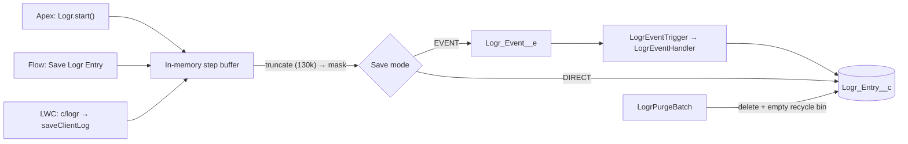

# Logr for Salesforce

[](https://developer.salesforce.com/)
[](https://developer.salesforce.com/)
[]()
[](LICENSE)

**One unit of work, one log record.** Logr is a small logging and telemetry framework for Salesforce. It captures the steps, callouts, DML outcomes and exceptions of a transaction in Apex, Flow and LWC, and saves them as a single readable `Logr_Entry__c`.

```text
Subject: Order Fulfillment
Level: ERROR (highest step)
Source:  OrderService.fulfillOrder (QUEUEABLE)
Limits:  Time: 506ms | CPU: 48/10000ms | SOQL: 3/100 | DML: 1/150 | Heap: 124/6000KB
```
```
[14:22:01.104 | +0ms   | INFO ] Validated order header
----------
[14:22:01.189 | +85ms  | DEBUG] Order lines: [ { "Id": "802g7000000xyz1AAA", "Quantity": 2 } ]
----------
[14:22:01.610 | +506ms | ERROR] SAP Order API
POST https://api.sap.example.com/v1/orders
Request Body: {"orderId":"EXT-ORD-9941","email":"[REDACTED-EMAIL]"}
Status: 503 Service Unavailable
```

You read the story of one failure top to bottom, in one place. No joining child rows, no digging through 24-hour debug logs.

---

## Is Logr right for you?

**Pick Logr if** you want a framework you can read in an afternoon, you value a trace-per-transaction view, and you are happy to own a small codebase.

**Pick Bolt Logger if** you only need lightweight error logging. It is smaller than Logr and does that one job well.

**Pick Nebula or RFLIB if** you need a live stream, archival, alerts, cross-entry correlation, queueable or REST saving, or a project with a large community. Logr is new and has one maintainer, so weigh that.

---

## What Logr does

- **One record per unit of work.** Steps are buffered in memory with `+elapsedMs` timestamps and written once.
- **Two save modes.** `EVENT` (default) publishes `Logr_Event__e` with `PublishImmediately`, so the log is not rolled back with your transaction. `DIRECT` inserts `Logr_Entry__c` immediately and **is** rolled back if the transaction fails.
- **Flush debug on error.** Run at `INFO` in production and keep `.debug()` / `.fine()` calls in code. A unit of work whose highest step is `ERROR` keeps all its steps. Otherwise, steps below the minimum level are dropped. (Only `ERROR` triggers the flush, not `WARN`.)
- **Callout and DML helpers.** `log.callout()` records method, endpoint, status and bodies, and raises the level on 4xx (`WARN`) and 5xx or null (`ERROR`). `log.dmlResults()` summarises `Database.SaveResult[]`, collects record IDs and row errors.
- **Context stamping.** `Source__c` gets `Class.method (CONTEXT)` using the stack trace and `Quiddity` (SYNC, QUEUEABLE, BATCH, FUTURE, trigger operation, FLOW, AURA, REST…). `User__c` and a governor-limit snapshot are stamped as well.
- **Per-user levels.** `Logr_Config__c` is a hierarchy custom setting: org default, then profile, then user. Turn on `DEBUG` for one user in production.
- **PII masking.** Five regex rules ship as custom metadata (credit card, email, US SSN, US phone, IPv4). Add or toggle rules without a deploy. See the limits below.
- **Keeps the start and the end of huge logs.** `Body__c` holds about 130,000 characters. If a log is bigger, Logr keeps the first 60,000 and the last 65,000 and replaces the middle with a `[TRUNCATED n CHARS]` marker. Cutting only the end would lose the exception, which is usually the last thing logged. Steps in the middle are lost.
- **Retention.** `LogrPurgeBatch` deletes logs older than `Retention_Days__c` and empties them from the recycle bin.
- **Zero config.** Defaults: enabled, `INFO`, `EVENT`, flush on error, masking on, 30 days.
- **Reports.** One dashboard and five reports, plus a record page.

---

## How it compares

Logr stands on good work by others. [Nebula Logger](https://github.com/jongpie/NebulaLogger) and [RFLIB](https://github.com/j-fischer/rflib) are mature platforms with features Logr will not match (live stream, archival, notifications, plugins). [Bolt Logger](https://github.com/batra-kapil/Bolt-Logger) showed that a logger can be small. Logr aims at the space between: a general-purpose logger you can read in an afternoon.

| | **Logr** | Bolt Logger | Nebula Logger | RFLIB |
| :-- | :-- | :-- | :-- | :-- |
| **Built for** | Traces, callouts, DML and errors | Error logging | Full logging platform | Logging plus a wider library suite |
| **Size (core)** | 4 objects, 4 classes | 4 objects, 2 classes | 15 objects, 42 classes | 13 objects, 79 classes |
| **A transaction becomes** | **One readable record** | One record per error | Parent log + child entries | Log rows |
| **Keeps debug steps when an error hits** | **Yes** | No | Not documented | Yes |
| **Built-in callout and DML summaries** | **Yes** | No | Yes | Not checked |
| **Live view, archival, alerts** | No | No | Yes | Yes |
| **Log purging** | Yes (batch, retention days, empties recycle bin) | Yes (nightly batch) | Yes (retention date + batch) | Yes (cleanup jobs) |
| **Data masking** | **Yes** (regex rules in metadata, on by default) | Yes (regex rules, first 2,000 chars) | Yes (rules in metadata) | Yes |

Sizes and features come from reading each repository (on 2026-10-20). Check them again before you rely on this comparison.

- **Choose Logr** when you want a small, general-purpose logger with a clear trace per transaction. 
- **Choose Bolt Logger** when you only need lightweight error logging. It is smaller than Logr and does that one job well. 
- **Choose Nebula or RFLIB** when you need a live stream, archival, alerts or a large ecosystem. 

---

## Known limitations

Read this before putting Logr in a regulated or high-volume org.

**Data loss**
- **Failed inserts are silent.** `LogrEventHandler` inserts with `allOrNone=false` and does not inspect the results. A rejected log record disappears without a trace.
- **Silent drops near limits.** If DML statements or rows are near the limit, `persistEntries` returns without saving or reporting.
- **Flow always reports success.** `Save Logr Entry` returns `isSuccess = true` even when logging is disabled or the save fails.
- **`DIRECT` mode rolls back** with the surrounding transaction.
- **One stack trace per entry.** The last exception wins. Earlier exception messages stay in the body, but not their stack traces.

**Privacy**
- **Masking fails open under CPU pressure.** Above 80% of the CPU limit, the rest of the text is saved **unmasked**.
- **Masking works in 2,000-character windows split on newlines.** One long line, such as minified JSON from a callout, is cut at fixed points, so an email or card number can straddle a cut and escape the regex.
- **Only `Body__c` and `Stack_Trace__c` are masked.** `Subject__c` is auto-filled from the first step if you do not set one, and it is not masked. Tags, Records, Source and `User__c` (the username) are not masked either.
- **Callouts log raw bodies and the full endpoint.** Headers are not logged, but tokens in a query string are, unless a rule matches them.

**Cost**
- **Debug payloads cost CPU and heap even when discarded.** They are serialised when you call `.debug()`, because they might be needed after an error. A unit of work at `INFO` still writes a record.
- **Each `Logr` does extra work.** It parses a stack trace on creation and stays in a static list for the transaction. Create one logger per unit of work, not one per record in a loop.
- **Event volume counts.** Telemetry-level use consumes platform event publish and delivery allocation. Not measured here.

**Security**
- **`saveClientLog` trusts its caller.** Any user with `Logr_User` can write entries with any level, source and subject, and can pick `DIRECT`. That allows spoofing and flooding, which matters for Experience Cloud users. There is no rate limit.
- **LWC level filtering is coarse.** The component sends all its steps as one block at the highest level, so flush-on-error does not apply to client logs.

**Missing features**
- No live stream, no archival, no transaction or request ID, no notifications.
- `Recent Live Logs` is a report, not a stream.

**Quality signals**
- Roughly 1,200 lines of Apex tests and a Jest suite exist. Coverage has **not** been measured for this README. Run the tests in your org before you quote a number.

---

## Install

**Unlocked package (`Logr@1.1.0-1`)**

```bash
sf package install --package 04tg7000000ZCRJAA4 --target-org <alias> --apex-compile package --wait 10
```

Production: <https://login.salesforce.com/packaging/installPackage.apexp?p0=04tg7000000ZCRJAA4>
Sandbox: <https://test.salesforce.com/packaging/installPackage.apexp?p0=04tg7000000ZCRJAA4>

**From source**

```bash
git clone https://github.com/nithesh1992/Logr.git && cd Logr
sf project deploy start --source-dir force-app/main/default/Logr --target-org <alias>
```

## Set up

1. **Permission sets.** `Logr_Admin` for people who read logs. `Logr_User` for everyone who triggers logs from LWC or Flow, which gives access to `Logr` and create on `Logr_Event__e`, not to the entries.
   ```bash
   sf org assign permset --name Logr_Admin --target-org <alias>
   ```
2. **Optional config.** Setup → Custom Settings → **Logr Config** → Manage. Fields: `Enabled__c`, `Level__c` (ERROR, WARN, INFO, DEBUG, FINE), `Default_Save_Mode__c`, `Flush_Debug_On_Error__c`, `Mask_Data__c`, `Retention_Days__c`. Set a row for a single user or profile to raise the level temporarily.
3. **Masking rules.** Setup → Custom Metadata Types → **Logr Data Mask Rule** → Manage Records. Add rules for your own identifiers. Review the limits above.
4. **Schedule the purge.**
   ```apex
   System.schedule('Logr Nightly Purge', '0 0 2 * * ?', new LogrPurgeBatch());
   ```
   Or run it once: `Database.executeBatch(new LogrPurgeBatch(7), 2000);` keeps 7 days.

---

## Usage

### Apex

```apex
public void processOrder(Order ord, List<OrderItem> items) {
    Logr log = Logr.start('Process Customer Order').tag('OMS').recordId(ord.Id);
    log.add('Validated order header');       // alias for info()
    log.debug('Order items', items);          // kept only if an ERROR follows

    try {
        HttpRequest req = SapClient.buildRequest(ord, items);
        HttpResponse res = new Http().send(req);
        log.callout('SAP Order Sync', req, res);

        Database.SaveResult[] results = Database.update(items, false);
        log.dmlResults('Update Order Items', results, items);
    } catch (Exception ex) {
        log.error('Order processing failed', ex);
    } finally {
        log.save();          // uses Default_Save_Mode__c
        // log.saveDirect(); // force DML
        // log.saveViaEvent(); // force platform event
    }
}
```

Several loggers in one transaction: call `Logr.saveAll()` once at the end. In `Database.Stateful` batches a logger can be a member variable. Payloads are turned into strings when added, and `save()` keeps the subject and tags for the next chunk.

### Lightning Web Components

```javascript
import { createLogr, logError } from 'c/logr';

async handlePayment() {
    const log = createLogr('Customer Checkout').source('checkoutSummary')
        .tag('Stripe').recordId(this.recordId);
    log.info('Initializing payment intent');
    try {
        log.debug('Gateway response', await authorizeCard());
    } catch (error) {
        log.error('Payment failed', error);
    } finally {
        await log.save();           // never throws; resolves false on failure
    }
}

// One-liner:
await logError({ subject: 'Checkout UI Crash', error, source: 'checkoutSummary',
                 tags: 'LWC, Checkout', recordId: this.recordId });
```

`logInfo({ subject, message, ... })` works the same way.

### Flow

Add the **Save Logr Entry** action (category `Logr`), on a normal path or a fault path. Inputs: Subject (required), Message, Level, Source, Tags, Record IDs, Fault Message (`{!$Flow.FaultMessage}` forces `ERROR` and fills the stack trace), Save Mode.

---

## Architecture



```text
force-app/main/default/Logr/
├── classes/       Logr (API, Flow action, LWC endpoint) · LogrUtil (format, mask, persist)
│                  LogrEventHandler · LogrPurgeBatch · 4 test classes
├── triggers/      LogrEventTrigger
├── lwc/logr/      headless logger + Jest tests
├── objects/       Logr_Entry__c · Logr_Event__e · Logr_Config__c · Logr_Data_Mask_Rule__mdt (30 fields)
├── customMetadata/ 5 default mask rules
├── flexipages/ layouts/ tabs/   record page, layout, tab
├── dashboards/ reports/         1 dashboard, 5 reports
└── permissionsets/              Logr_Admin · Logr_User
```

## License

MIT. See [LICENSE](LICENSE).
